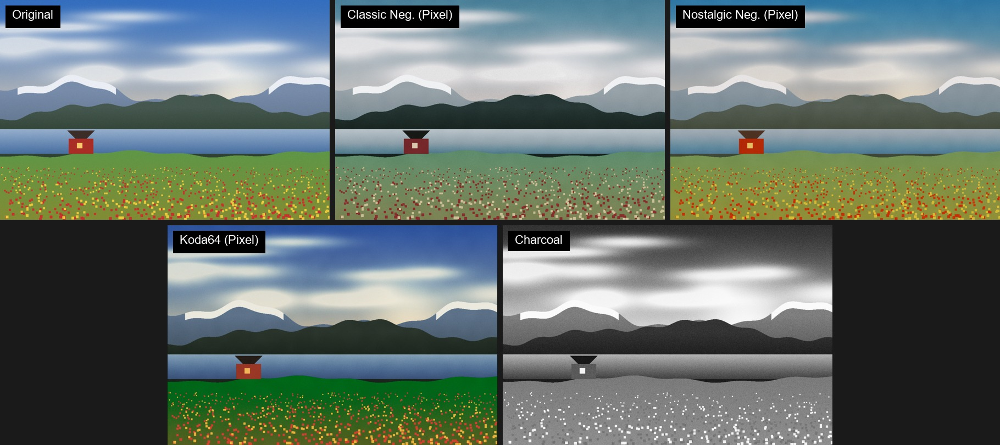

<p align="center"></p>

# FujiVibe

**An Android camera app that gives phone photos a Fujifilm-style film look, tuned for how Pixel phones actually process their photos.**

Film looks made for Fujifilm cameras tend to look flat or muddy on phone photos, because phones already brighten shadows and flatten contrast before you ever see the image. FujiVibe keeps the familiar looks but rebuilds each one for Pixel photos, tuned by eye against real shots. There is a black-and-white look too. The app itself stays simple: shoot, swipe between looks, save the ones you like, and look back through them in the app. Shots can wait, so you can keep shooting and pick the looks later. For a Fujifilm X-T5 it can also load film recipes into the camera's own custom slots over USB, so the camera applies them as you shoot.



<sub>The scene is computer-generated, so no personal photos are published. It was rendered by the app's own color engine.</sub>

## How it works

1. **Shoot:** back or selfie camera, with zoom, ISO and shutter speed on one fold-away ruler. Leave ISO or shutter on Auto and the camera fills it in; set both for full manual, with a brightness readout (e.g. `+1.0 EV`). The top bar holds a grid, a level line, a 3s/10s self-timer, the photo shape (4:3, 3:2 (Fujifilm's native shape), 1:1 or 16:9) and a button for the Library. Each shot goes to the **Roll** and you stay on the camera, ready for the next one; a thumbnail beside the shutter shows how many are waiting. The Roll holds up to 50 shots and keeps each for 30 days. The sparkle button in the top bar turns on "develop after each shot", which opens Review straight after every shot instead.
2. **Review:** tap the thumbnail to open the Roll and pick a shot to develop. Swipe between the original photo and each film look. Pinch or double-tap to zoom in on the detail of whichever look you're on. A line under the photo shows what it was shot with, e.g. `ISO 400 · 1/250 · 1x · 3:2`.
3. **Export:** save the look you're on at full resolution to `Pictures/FujiVibe`, with the photo's date and camera settings kept. The file is named after the look and the time, e.g. `ClassicNegPixel_20261011_021224.jpg`. You can save several looks from the same shot.
4. **Done:** the shot leaves the Roll. Go back instead to leave it there for later.
5. **Library:** from the top bar, browse everything you've saved as thumbnails marked with their look. Open one to swipe through them, pinch to zoom right in at full detail, or delete it (on Android 11 and later it goes to your phone's trash, so it can be restored).
6. **Camera recipes (X-T5):** the sliders button in the top bar opens a screen for a Fujifilm X-T5 connected by USB. Pick a recipe for each of the camera's custom slots C2 to C7 (C1 stays as your default) from a set of researched recipes, each with a note on what it suits, or paste in your own. FujiVibe backs up the slots, writes the recipes, reads each back to check it, and can restore the backup. The camera then applies the recipe as you shoot. The camera must be in its USB RAW CONV./BACKUP RESTORE mode, awake, and the phone must be the USB host.

No download is published yet. Build it with the commands below and install it on an Android 10+ phone. It was built and tested on a Pixel 10 Pro.

## What makes it different

- **Looks adjusted for phone photos.** Each color look combines the original film-look color table with extra corrections (contrast, tint, color shifts), all merged into a single table. The black-and-white look has no source table: it is worked out directly from a monochrome conversion and a tone curve, with stronger grain. Either way the app does one quick lookup per pixel, and retuning a look means changing a few numbers.
- **Choose after you shoot, even much later.** You compare looks on the actual photo instead of guessing from a live preview, and shots wait on the Roll so a run of photos isn't interrupted.
- **Recipes for a real Fujifilm camera.** Beyond the phone looks, it loads Fuji film recipes (film simulation, grain, Color Chrome, tone, white balance and more) into an X-T5's custom slots, checked against what the camera itself reports.
- **Camera-like controls.** Manual ISO and shutter speed with an Auto option for each, a level line, and a 3:2 frame, presented like a camera's own display.

## Build it

Requires JDK 21 and the Android SDK.

```bash
./gradlew :render:test :app:testDebugUnitTest :app:assembleDebug
```

```bash
adb install -r app/build/outputs/apk/debug/app-debug.apk
```

To preview any photo through the looks on a computer, without a phone:

```bash
./gradlew :render:previewFilmSimulation --args="in.jpg out.jpg ORIGINAL,CLASSIC_NEG_PIXEL,CHARCOAL"
```

The project has two parts: a color engine (`render/`) that is plain Kotlin and fully unit-tested, and the Android app (`app/`), built with Jetpack Compose and CameraX.

## Limitations

- Saving a full-resolution photo isn't instant; a spinner shows while it works.
- Zooming in Review shows a sharper version of the look, but not the full-size photo, so very close up it is softer than the saved file. The Library zooms the saved photo itself, to full detail.
- Looks are tuned by eye on a limited set of photos, and low-light shots come out dark.
- No flash or portrait (background blur) mode. The Pixel 10 Pro doesn't offer portrait blur to other apps.
- With one of ISO or shutter set by hand, the other is based on the scene when you started adjusting, and doesn't follow later changes in light.
- Tested on one phone; no store release.
- Camera recipes works only with the X-T5 (tested on firmware 4.31). It uses Fujifilm's unofficial USB protocol, which a firmware update could change, and a few settings are not written yet (such as most noise reduction steps and the monochrome colour shifts); the screen says so for each recipe.

## Roadmap

- Fine-tune the looks on more real Pixel photos.
- A downloadable release.
- Later ideas: telling close-up portraits from landscapes automatically, and cropping to the main face.
- Camera recipes: suggesting the best seven recipes for a trip or a scene, and keeping named sets.
- Developing RAW (`.RAF`) files with the camera over USB was built and tested (about 1 s per look, 10 MP results) and then set aside; see `docs/adr/0013-develop-raf-in-the-camera.md`.

## Privacy

FujiVibe works entirely on your phone. It asks for camera access, and for access to your photos if you open the Library, so it can show what it saved (Android hides photos from an app once another app, such as Google Photos, takes them over). It cannot use the internet: no accounts, tracking or ads. The level line reads the phone's motion sensor on the device only, and your camera settings are remembered on the phone. The Camera recipes screen talks only to an X-T5 you plug in, over USB; nothing is sent anywhere else. Photos go only to your phone's `Pictures/FujiVibe` folder.

## License and credits

- **Code:** [MIT](LICENSE).
- **Color tables** (`derived-luts/`): adapted from [abpy/FujifilmCameraProfiles](https://github.com/abpy/FujifilmCameraProfiles) by abpy, under [CC BY-NC-SA 4.0](https://creativecommons.org/licenses/by-nc-sa/4.0/) (non-commercial, share-alike). The one exception is the black-and-white table, which FujiVibe generates itself. See [details](derived-luts/LICENSE.md).
- **Recipes:** two looks approximate published Fujifilm recipes in their own way: the black-and-white look follows Kevin Mullins' [black-and-white recipe](https://www.kevinmullinsphotography.co.uk/blog/fujifilm-recipe-black-and-white), and the Kodachrome-style look follows the Kodachrome 64 recipe from Fuji X Weekly.
- **Camera recipes:** the settings in `app/src/main/assets/recipes.json` come from recipes published by their authors, each with a link: Reggie Ballesteros (Reggie's Portra), Anders Lindborg (Kodak Tri-X 400, not in the default set), Ritchie Roesch of [Fuji X Weekly](https://fujixweekly.com) (Kodachrome 64, Vibrant Arizona, Pacific Blues), Kevin Mullins (Newspaper, Lighthouse), and Justin Gould of [film.recipes](https://film.recipes) (Woodland Negative). Soft Alpine's author is unknown. The notes on what each suits are written for this project. The USB protocol for the camera's slots follows the work of [FilmKit](https://github.com/eggricesoy/filmkit) and [libfuji](https://github.com/petabyt/libfuji) (both MIT), checked against a real X-T5.
- **Font:** [Barlow Semi Condensed](https://github.com/jpt/barlow) by The Barlow Project Authors, under the [SIL Open Font License 1.1](third_party/BarlowSemiCondensed-OFL.txt).
- **Icons:** [Material Symbols](https://github.com/google/material-design-icons) by Google, under the Apache License 2.0.
- FujiVibe is an independent project, not affiliated with Fujifilm, Kodak or Google. Look names refer to their trademarks only to describe the styles the app approximates.

## How this project was built

I led this project as its product owner: I set the direction and scope, made the product decisions (what to build, what to cut, how each look should feel), judged every look on real photos, and tested every change on my own phone. AI coding agents (Claude Code) did most of the implementation, working to my direction.

What kept the work reliable:

- **Written decisions.** A product spec, a glossary and a log of key decisions, so work never depended on memory.
- **Small, well-defined tasks,** each with a clear finish line.
- **Automated tests and a build check** before any change was accepted.
- **Hands-on testing on a real phone.** My feedback drove the fixes. Some ideas, like portrait mode, were dropped after testing showed the phone didn't support them.
- **A clear Git history** of small, described changes.
